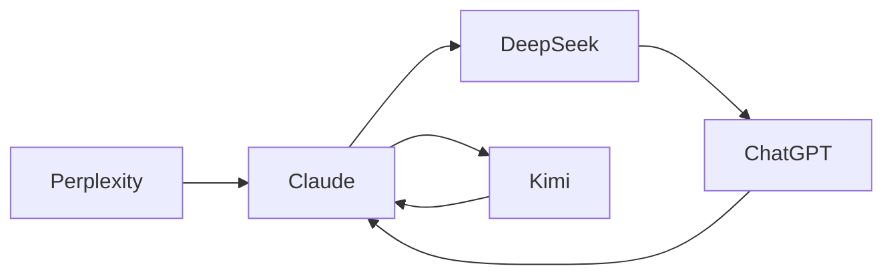

# AI Opportunity and Implementation Consultant

> **Статус:** 🟡 Инициализация — архитектура утверждена, роли Perplexity и Claude описаны, первый рабочий цикл не запущен.
> **Последнее обновление:** 04.09.2026

---

## 1. Цель проекта

**AI Opportunity and Implementation Consultant** — система бизнес-диагностики,
которая на входе принимает данные о произвольной компании, а на выходе выдаёт
отчёт (или «книгу диагностики») с рекомендациями, где и как внедрять AI-агентов.

Учебная рамка проекта в целом (по `ai-agenty-proekt-vyzhimka.md`): площадка для
отработки создания и оркестрации AI-агентов на бесплатных инструментах,
приближённая к промышленному стандарту работы.

### Вход системы ✅ (закрыто TASK-000, детали — в ТЗ v1.2)
- Схема бизнес-процессов компании (as-is)
- Материалы интервью сотрудников (обрабатываются через Digest по сотруднику)
- Общие корпоративные документы (регламенты, оргструктура, отчётность и т.п.)
- `manifest.md` — реестр входных материалов клиента (путь, тип, batch ID)

### Обработка
Детали зафиксированы в ТЗ v1.2 (REQ-01–REQ-20): включает Чек-лист зрелости 0–5,
формирование Digest по сотруднику из транскриптов. Точная последовательность
обработки — предмет декомпозиции в TASK-001 (Claude-Архитектор).

### Выход системы ✅ (закрыто TASK-000, детали — в ТЗ v1.2)
«Книга диагностики» (~20 страниц MVP) в нескольких форматах:
- Веб-отчёт (HTML + PDF) — структура: Executive Summary, AS-IS, TO-BE, Карта
  процессов, Дорожная карта, ROI
- DOC-версия для разработчиков
- CSV-экспорт для Draw.io (визуализация процессов)
- Telegram-бот пред-квалификации (3 вопроса) как отдельная точка входа лидов

### Первая задача проекта (TASK-000) — ✅ ЗАВЕРШЕНА
Итоговое ТЗ (v1.2) утверждено 07.09.2026: 20 требований, 12 референсов, все
открытые вопросы по продукту закрыты. См. `decisions-log.md`, запись от
07.09.2026, и `status-current.md`.

**Текущая задача — TASK-001:** передача ТЗ Claude-Оркестратору для декомпозиции
на атомарные задачи для DeepSeek. Остаются на решение архитектора: выбор
инструмента транскрипции, хранилище для накопления эталона, сценарий диалога
Telegram-бота (см. `status-current.md`, «Открытые вопросы»).

## 2. Архитектура: 5 ролей + встроенный Арбитр

| № | Роль | Инструмент | Что делает |
|---|---|---|---|
| 0 | Аналитик / Консультант | Perplexity | Сбор требований, research мировых практик, формирование ТЗ |
| 1 | Оркестратор / Архитектор / Финальный QA / Документалист / Арбитр | Claude | Декомпозиция, ведение документации, приёмка, разрешение конфликтов |
| 2 | Разработчик (Generator) | DeepSeek | Кодогенерация |
| 3 | Независимый ревьюер (Evaluator) | ChatGPT | Ревью кода, безопасность, архитектура |
| 4 | Тестировщик / QA | Kimi | Тест-кейсы, edge cases |

Полная схема и обоснование выбора инструментов — см. `ai-agenty-proekt-vyzhimka.md`.



## 3. Протокол хендоффа (кратко)

1. Перед сессией — загрузить в инструмент **два разных типа контекста**:
   - `role-*.md` соответствующего агента — **один раз** как база знаний/Custom Instructions (не меняется от задачи к задаче);
   - `status-current.md` + конкретная задача — **сообщением в чат**, заново на каждую сессию (это то, что реально меняется).
2. В конце сессии — получить результат в строгом формате роли, включая блок **ДЕЛЬТА ИЗМЕНЕНИЙ**.
3. Перед перезаписью `status-current.md` — сохранить копию в `history/snapshot-ГГГГ-ММ-ДД-ЧЧММ.md`.
4. Значимые решения — отдельной строкой в `decisions-log.md`.

Полный протокол — см. `ai-agenty-proekt-vyzhimка.md`, раздел 3.

## 4. Структура репозитория

```
project-name/
  README.md
  handoff-cheatsheet.md
  status-current.md
  glossary.md
  decisions-log.md
  lessons-learned.md
  deliverables/
    TASK-000-TZ-v1.2.md
  history/
    snapshot-ГГГГ-ММ-ДД-ЧЧММ.md
  prompts/
    role-perplexity.md   ✅ готов
    role-claude.md        ✅ готов
    role-deepseek.md      🔶 черновик v0.1
    role-chatgpt.md       🔶 черновик v0.1
    role-kimi.md          🔶 черновик v0.1
  src/
  tests/
    unit/
    integration/
    acceptance/
```

## 5. Текущий статус

- [x] Архитектура ролей утверждена
- [x] `role-perplexity.md`, `role-claude.md` созданы
- [x] `role-deepseek.md`, `role-chatgpt.md`, `role-kimi.md` — черновики v0.1
- [x] `status-current.md`, `glossary.md`, `decisions-log.md`, `lessons-learned.md` — созданы и актуализированы
- [x] **TASK-000 завершён** (07.09.2026): Stakeholder Interview + research + итоговое ТЗ v1.2 (20 требований, 12 референсов)
- [ ] **TASK-001 в работе:** передача ТЗ Claude-Оркестратору, декомпозиция на подзадачи для DeepSeek

## 6. Ссылки на ключевые файлы

| Файл | Назначение |
|---|---|
| `ai-agenty-proekt-vyzhimka.md` | Полная архитектура и обоснование решений |
| `handoff-cheatsheet.md` | Быстрый ориентир: какой триггер какому агенту дать и куда вставить результат |
| `deliverables/` | Полные тексты крупных документов-артефактов (ТЗ, отчёты) — по одному файлу на версию, не перезаписываются |
| `prompts/role-*.md` | Должностные инструкции агентов |
| `status-current.md` | Текущий статус (появится после первой сессии) |
| `glossary.md` | Единый словарь терминов |
| `decisions-log.md` | Журнал решений |
| `lessons-learned.md` | Ретроспектива и коррекция промптов |
